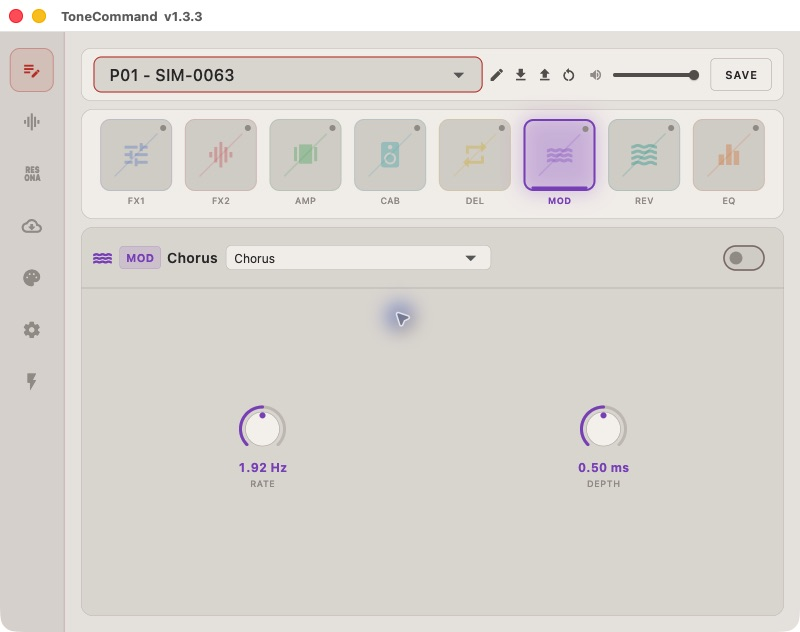

NanoCore reverse-engineering research
====================================

Research toward running custom Uni-Vibe and POG-style effects on the Livtra
NanoCore. This repository contains selected tools, protocol findings and
compact evidence from firmware/app analysis through 2026-11-06.

No physical pedal has been tested. NanoCore executable decoding and acceptance
of modified firmware remain unresolved. The uploader is simulator-tested;
successful host transfers do not establish that a device will install or boot
the image.

See it running
--------------

`Open the screenshot gallery <docs/evidence-gallery.rst>`_ for device selection,
the live editor, modulation controls and synthetic preset names, plus a fresh
native-emulation result. These are actual app screenshots. The GUI uses
recorded synthetic API responses; the separate native run executes the real
updater against simulated USB/MIDI.

What is here
------------

* ``tools/nanocore_dfu``: independent protocol-1 uploader, offline simulator,
  structural package inspection, and tests.
* ``tools/host_pack``: complete decoder for ToneCommand's AHPK resource archive.
  All 472 entries in the inspected archive were recovered and checked.
* `Research status <docs/research-status.txt>`_: conclusions, limitations and
  the remaining deployment questions.
* `Firmware format <docs/firmware-format.txt>`_: LUM0/FMUC layout and identity.
* `Device protocol <docs/protocol.txt>`_: normal MIDI, preset reads, DFU entry
  and the observed USB upload sequence.
* `Resource format <docs/resources.txt>`_: decoder derivation, reproduction and
  useful recovered content.
* ``evidence``: public artifact URLs/hashes, a payload-free native transfer
  trace, resource metadata and a synthetic normal-runtime summary.

Installers, firmware images, decoded vendor assets, virtual environments,
large disassemblies and exploratory runtime logs are intentionally absent.
The local research workspace can keep them alongside this checkout; the
root .gitignore uses an allowlist to prevent accidental bulk additions.

Run without a device
--------------------

Python 3.10 or later; no packages are needed for offline tools or tests::

    python3 -m unittest discover -s tools/nanocore_dfu -p test_uploader.py -v
    python3 tools/nanocore_dfu/uploader.py inspect /path/to/nanocore-1.12.fmu
    python3 tools/nanocore_dfu/uploader.py simulate /path/to/nanocore-1.12.fmu --output /path/to/new-output

The default suite runs 22 tests with synthetic data and mocked USB. One extra
test checks the real firmware against every outbound transfer hash when a
matching local image is supplied::

    NANOCORE_FIRMWARE=/path/to/nanocore-1.12.fmu python3 -m unittest discover -s tools/nanocore_dfu -p test_uploader.py -v

The optional firmware must match the SHA256 in
``evidence/vendor-dfu-trace.json``; a different image fails that test. Download
locations and hashes for the seven inspected releases are in
``evidence/firmware-sources.json``. Tests never download or flash anything.

See `uploader instructions <tools/nanocore_dfu/README.txt>`_ before using the
separate, unvalidated physical backend. It requires PyUSB/libusb, explicit
bus/address selection, and a pedal already in DFU mode.

Evidence conventions
--------------------

"Observed native behavior" means shipped ToneCommand code ran against fake
peripheral boundaries. Device replies and presets in those experiments were
synthetic. "Recovered resource" means format/hash/checksum validation passed;
it does not imply recovered executable DSP code. The resource secret and
publisher verification key documented here come from shipped app artifacts,
not account credentials or a private firmware signing key.
