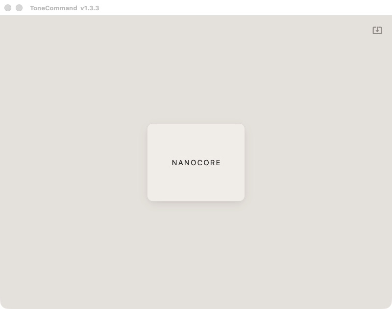
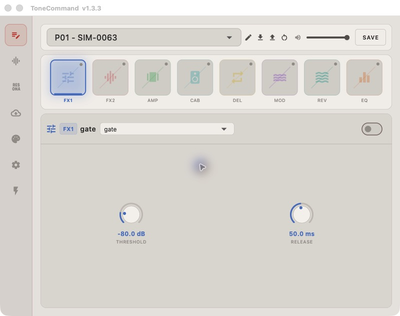
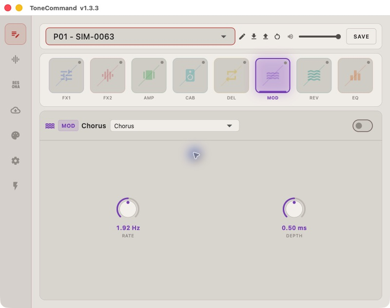
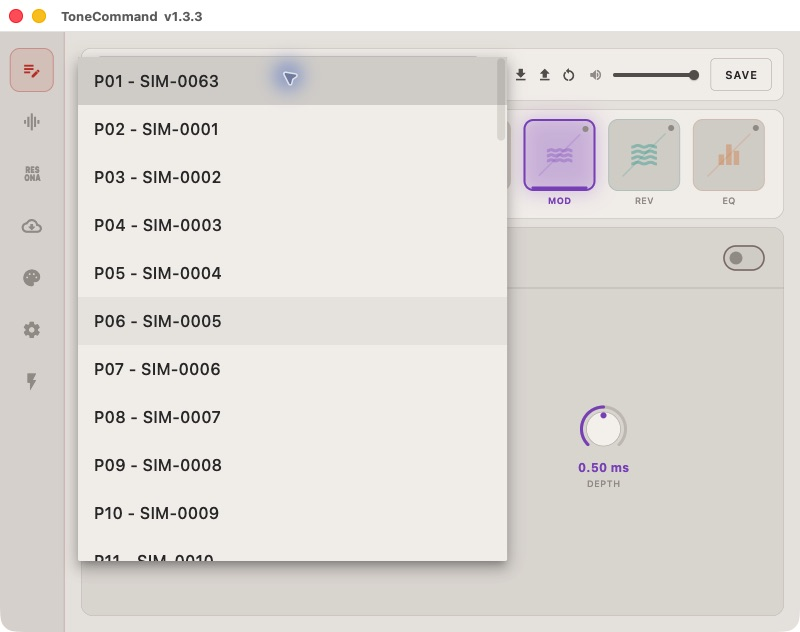

NanoCore evidence gallery
========================

Captured on 2026-11-06 from the actual ToneCommand 1.3.3 interface. The image
bytes came directly from the computer-use screenshot API; they were not
generated, composited, annotated or retouched. Only the instrumented app
window is shown.

Two experiments are represented here:

* **GUI response experiment:** an owned app clone consumes synthetic native
  API responses previously obtained from the protocol emulator. Its real
  Flutter UI and resource loader run. The native ``a2`` entry is replaced,
  and network/device/helper access is blocked.
* **Native protocol experiment:** the unmodified vendor ``a2`` implementation
  runs with fake CoreMIDI/libusb boundaries. The host parses the replies,
  requests DFU, checks the firmware and transmits its signed core. This run
  has its own log and result file below; it is not the GUI screenshot run.

Neither experiment uses a physical pedal or establishes working audio DSP,
firmware decryption, or device acceptance of a modified image.

1. The app recognizes the synthetic device
-----------------------------------------

The normal-device enumeration response makes the NANOCORE tile appear.
Selecting it opens the editor; no USB pedal is attached.

2. The editor loads and displays returned state
----------------------------------------------

The startup/readiness response allows the app to reach its editor. The effect
chain, preset selector, volume and gate controls are rendered by ToneCommand.
The synthetic snapshot has disabled effect slots, as shown by the switches.

The fixed preset-read fixture contains ``SIM-0063``, even when the GUI's active
slot is P01. That mismatch reflects the deliberately simple response fixture;
it is not evidence of a real device slot mapping or a real user's preset.

3. Switching panels changes the live interface
---------------------------------------------

Clicking MOD changes the editor to the built-in Chorus controls. This shows
the real UI responding to interaction, not execution of a Chorus algorithm
or a newly implemented Uni-Vibe effect.

4. Returned preset names populate the selector
---------------------------------------------

The dropdown contains names from the synthetic preset-list response. The
protocol fixture contains 64 names; this viewport shows the first portion.
The exact API-response fixtures are committed for inspection.

5. The native updater completes a separate emulated session
---------------------------------------------------------

The fresh native run completed seven calls: enumeration, global settings,
effect snapshot, preset listing, one preset backup, readiness and firmware
update. Its receipt reports:

.. code-block:: text

   Actual vendor native library executed; a2 responses were NOT replaced.
   USB/MIDI device IO was simulated. Physical device: FALSE.

   Results: 7/7 native API calls succeeded
   Wire: 15 MIDI requests; 15 simulated replies
   Backup: 64 names; 1 preset; 2 chunks; 190 unknown TLV bytes retained
   Transition: 1 MIDI detach; 178 DFU firmware blocks
   Signed core: 727,149 bytes; exact equality with original firmware prefix
   Executable decrypted: FALSE

This is a text excerpt from the actual run receipt, not a terminal screenshot.
The captured core hash is
``abee99ebe2fe6859e81e5c664c1bf322b95ed9206c8231f8a30ad7b49d324b31``.
The original library remained unchanged and the owned process was cleaned up.

`Full native-run log <../evidence/visual-session/native-runtime-log.txt>`_ |
`Machine-readable native result <../evidence/visual-session/native-runtime-result.json>`_

6. Runtime resource capture is corroborated in this session
---------------------------------------------------------

Opening the editor again triggered the real resource loader. The capture
contains 2,475 compressed bytes that decode to the 6,835-byte English string
table, matching the previously recovered asset hash. The GUI capture receipt
records that match. Full archive recovery remains documented in
`resources.txt <resources.txt>`_ and the
`472-entry manifest <../evidence/host-assets-manifest.json>`_.

Provenance
----------

`GUI capture receipt <../evidence/visual-session/gui-capture-result.json>`_
contains screenshot hashes, sizes, timestamps, intercepted API call counts,
the runtime asset match, guard state and cleanup confirmation.
`Exact synthetic API fixtures <../evidence/visual-session/gui-api-fixtures.json>`_
show the responses presented to the GUI. Raw runtime captures stay in the
local research workspace; their hashes are included in the receipts.

All owned probe processes were stopped after capture. No firmware was flashed
to hardware. The screenshots corroborate visible host behavior; the receipts
and protocol fixtures carry the more specific byte-level claims.
